# Punctuation Restoration for Mental-Health Counselling Text

[](https://colab.research.google.com/github/AbhishekSinghDasila/Punctuation-Restoration/blob/main/notebooks/Punctuation_Restoration.ipynb)


A system that takes **unpunctuated, lower-cased text** – the kind of output a speech-recognition engine produces – and
restores **commas, periods and question marks**. It combines a fine-tuned transformer token classifier (the
**internal language model**) with **GPT-2 N-best rescoring** (the **external language model**), and is evaluated against
pre-trained end-to-end punctuation models used zero-shot.

```
input : it sounds like a tough time and its normal to feel down have you talked to anyone about it
output: It sounds like a tough time, and its normal to feel down. Have you talked to anyone about it?
```

**Best result:** 80.4 micro-F1 on held-out test responses, vs 75.4 for the same pre-trained model before fine-tuning and
77.4 for a 2× larger pre-trained model.

> 📘 A long-form explanation with architecture diagrams, design reasoning and Q&A is in
> [`docs/Study_Guide.pdf`](docs/Study_Guide.pdf).

---

## Table of contents
1. [Problem formulation](#1-problem-formulation)
2. [System architecture](#2-system-architecture)
3. [Dataset](#3-dataset)
4. [Synthetic dataset creation and preprocessing](#4-synthetic-dataset-creation-and-preprocessing)
5. [Exploratory data analysis](#5-exploratory-data-analysis)
6. [Models](#6-models)
7. [Evaluation methodology](#7-evaluation-methodology)
8. [Results](#8-results)
9. [Error analysis](#9-error-analysis)
10. [Challenges and solutions](#10-challenges-and-solutions)
11. [Project structure](#11-project-structure)
12. [How to run](#12-how-to-run)
13. [Limitations and future work](#13-limitations-and-future-work)
14. [References](#14-references)

---

## 1. Problem formulation

Punctuation restoration is cast as **token classification**: the words never change, and every word receives one label –
the punctuation mark that **follows** it.

| label | meaning | characters mapped to it |
|---|---|---|
| `O` | no punctuation | – |
| `COMMA` | sentence-internal pause | `,` `;` `:` `-` |
| `PERIOD` | end of a statement | `.` `!` |
| `QUESTION` | end of a question | `?` |

```
words : chances  are    if you really think about it     there were signs   did you notice them
labels: O        COMMA  O  O   O      O     O     COMMA  O     O    PERIOD  O   O   O      QUESTION
```

This 4-class scheme is the standard one in the punctuation-restoration literature (e.g. IWSLT). Token classification
cannot add, drop or alter words – important for verbatim transcripts – and yields calibrated per-word probabilities that
can be combined with an external language model.

---

## 2. System architecture

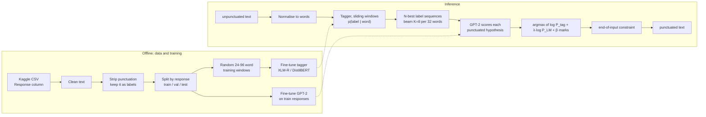

| component | role | implementation |
|---|---|---|
| **Internal LM** | pre-trained transformer encoder inside the tagger; supplies the language knowledge used to label every word | [`src/punct/tagger.py`](src/punct/tagger.py) |
| **External LM** | separate causal LM (distilgpt2) that re-ranks the tagger's N-best hypotheses by fluency | [`src/punct/lm_rescore.py`](src/punct/lm_rescore.py) |

### Tagger
```
words ─► sub-word tokenizer ─► transformer encoder (6/12/24 layers) ─► linear head ─► softmax over 4 labels
```
* Only the **first sub-token** of each word carries a label; continuation sub-tokens are ignored in the loss (`-100`).
* Long responses are processed in **100-word windows with stride 50**; each word keeps the prediction from the window in
  which it has the most context on both sides.
* For checkpoints that already have a punctuation head (`0 . , ? - :`), the head is **kept** and our labels are mapped onto
  it, so fine-tuning continues from the existing task knowledge.

### External LM rescoring
For each 32-word segment the tagger's 8 best label sequences are rendered as text and scored by GPT-2, conditioned on the
previous segment:

```
score(h) = log P_tagger(h) + λ · log P_GPT2(h | previous text) + β · (number of punctuation marks in h)
```

`λ` weights the LM and `β` compensates for the LM's bias against extra tokens. Both are grid-searched on the validation
set only. With `λ = 0` the system reduces to the tagger, so tuning can never hurt on validation.

### End-of-input constraint
The last word of an input always closes a sentence (PERIOD, or QUESTION when the model rates it higher). See
[challenge 9](#10-challenges-and-solutions) for why this is necessary.

---

## 3. Dataset

[NLP Mental Health Conversations](https://www.kaggle.com/datasets/thedevastator/nlp-mental-health-conversations) (Kaggle):
questions posted by users (`Context`) and answers written by licensed psychologists (`Response`). As required, only the
**`Response`** column is used.

| property | value |
|---|---|
| rows | 3,512 |
| missing responses | 4 |
| fully duplicated rows | 760 |
| unique responses | 2,479 |
| unique questions | 995 (2.8 answers per question on average) |

The dataset is not stored in this repository. The notebook downloads it with `kagglehub`; for local runs place
`train.csv` in `data/raw/`.

---

## 4. Synthetic dataset creation and preprocessing

The responses are already correctly punctuated, so supervision is created automatically (self-supervision): punctuation
is removed to form the input and kept as the label sequence.

| step | details |
|---|---|
| **Missing values** | 4 empty responses dropped |
| **Duplicates** | 760 duplicated rows dropped; 438 more responses that became identical after cleaning dropped |
| **Text cleaning** | Unicode NFKC, curly quotes → ASCII, non-breaking spaces removed; URLs, e-mails, base64 images, HTML, emoticons removed; 3,710 glued sentence boundaries (`with.Seriously`) repaired; line breaks / bullets treated as sentence ends |
| **Language filter** | 60 Spanish responses removed |
| **Special characters** | everything except letters, digits and apostrophes removed; hyphen/slash compounds split (`self-esteem → self esteem`) |
| **Lower-casing** | all words lower-cased (capital letters would leak sentence boundaries) |
| **Tokenisation** | whitespace word tokens (the labelled units) + model sub-word tokenisation inside the tagger |
| **Labelling** | trailing mark → label with priority `? > . > ,`; abbreviations (`e.g.`, `Dr.`) are not sentence ends |
| **Split** | 80 / 10 / 10 **by response** (seed 42): 1,582 train, 197 validation, 199 test |
| **Training samples** | train responses are concatenated into one stream and cut at random positions into 24–96-word windows (2 passes) → **8,884 windows** |

Random windows force the model to detect sentence boundaries anywhere in a sample, instead of learning that the last word
of a sample is always a period. Validation and test responses are punctuated end-to-end with the production
sliding-window inference.

---

## 5. Exploratory data analysis

| | |
|---|---|
| 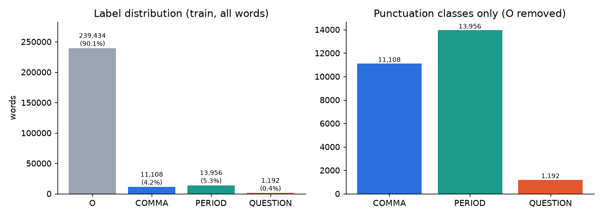 | 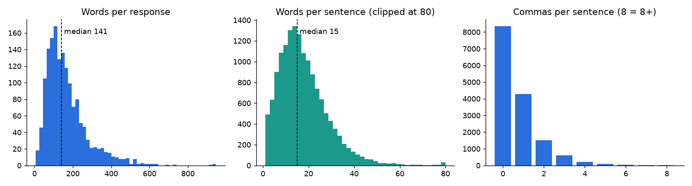 |
| 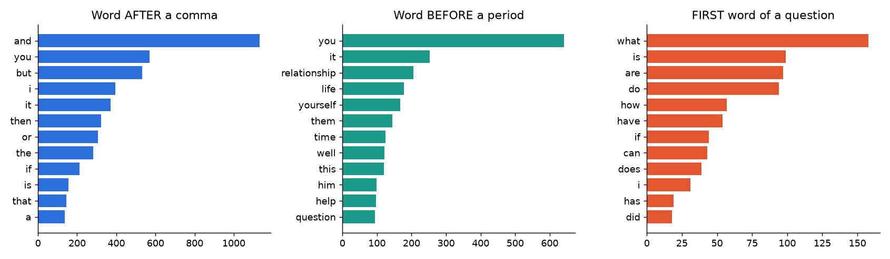 | 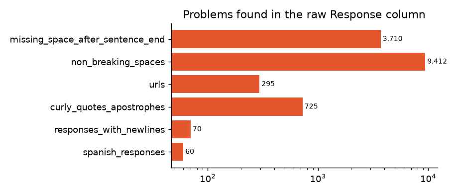 |

* **Strong imbalance:** 90.1 % `O`, 5.3 % `PERIOD`, 4.2 % `COMMA`, 0.45 % `QUESTION` → accuracy is meaningless; per-class F1 is reported.
* **Lengths:** median response 141 words (max 946) → sliding-window inference is required; median sentence 15 words.
* **Lexical cues:** commas are often followed by *and / but / then / or*; questions start with *what / is / are / do / how*. The
  question cue sits at the start of a sentence while the label sits at the end, so long-range context is needed.
* **Splits are representative:** class shares are nearly identical in train / val / test.

---

## 6. Models

| system | type | parameters | training |
|---|---|---|---|
| Rule baseline | period at the end of each response only | – | – |
| [`kredor/punctuate-all`](https://huggingface.co/kredor/punctuate-all) | pre-trained punctuation model, XLM-RoBERTa base | 278 M | none (zero-shot) |
| [`oliverguhr/fullstop-punctuation-multilang-large`](https://huggingface.co/oliverguhr/fullstop-punctuation-multilang-large) | pre-trained punctuation model, XLM-RoBERTa large | 560 M | none (zero-shot) |
| XLM-R base + domain FT | `punctuate-all` fine-tuned on our windows, original head kept | 278 M | 1 epoch, lr 2e-5 |
| DistilBERT + domain FT | [`distilbert-base-uncased`](https://huggingface.co/distilbert-base-uncased) with a new 4-way head | 66 M | 3 epochs, lr 5e-5 |
| + GPT-2 rescoring | [`distilgpt2`](https://huggingface.co/distilgpt2), generic or fine-tuned on train responses (2 epochs) | 82 M | λ, β tuned on validation |

Common training settings: AdamW (weight decay 0.01), 10 % linear warm-up then linear decay, batch size 16, max length
256 sub-words, gradient clipping 1.0, cross-entropy on the first sub-token of each word.

---

## 7. Evaluation methodology

* **Per-class precision / recall / F1** for COMMA, PERIOD, QUESTION (`O` is not scored).
* **Micro-F1** over the three classes (headline metric) and **macro-F1** (rare classes weigh equally).
* **Slot Error Rate** `SER = (substitutions + deletions + insertions) / reference marks` – standard in speech research, lower is better.
* **95 % bootstrap confidence intervals** (1,000 resamples of test responses) and **paired bootstrap tests** between systems.
* Hyper-parameters (epochs, λ, β, the end-of-input constraint) were chosen on validation; the test set was used only for final reporting.

---

## 8. Results

Held-out test set: 199 responses, 36 k words, 3,390 punctuation marks. All values in %.

| system | COMMA F1 | PERIOD F1 | QUESTION F1 | micro P | micro R | **micro F1** | macro F1 | SER ↓ |
|---|---|---|---|---|---|---|---|---|
| Rule: period at end only | 0.0 | 19.4 | 0.0 | 97.0 | 5.7 | 10.8 | 6.5 | 94.3 |
| XLM-R base punct. model (zero-shot) | 62.3 | 85.4 | 83.7 | 74.1 | 76.6 | 75.4 | 77.1 | 40.5 |
| XLM-R large FullStop (zero-shot) | 64.8 | 86.8 | 87.7 | 76.5 | 78.3 | 77.4 | 79.8 | 36.4 |
| XLM-R base + domain FT | 66.8 | 87.3 | 85.8 | 80.6 | 77.4 | 78.9 | 80.0 | 32.7 |
| DistilBERT + domain FT | 57.3 | 79.1 | 71.3 | 72.8 | 67.4 | 70.0 | 69.2 | 45.6 |
| DistilBERT FT + GPT-2 (generic) | 60.1 | 82.3 | 73.2 | 76.1 | 70.1 | 73.0 | 71.9 | 40.9 |
| DistilBERT FT + GPT-2 (domain) | 63.0 | 83.5 | 76.8 | 76.1 | 73.5 | 74.8 | 74.4 | 39.3 |
| XLM-R base FT + GPT-2 (generic) | 68.7 | 87.5 | 85.1 | 79.4 | 79.7 | 79.5 | 80.5 | 32.3 |
| **XLM-R base FT + GPT-2 (domain)** | **69.3** | **88.4** | 86.7 | 80.5 | 80.3 | **80.4** | **81.5** | **31.0** |

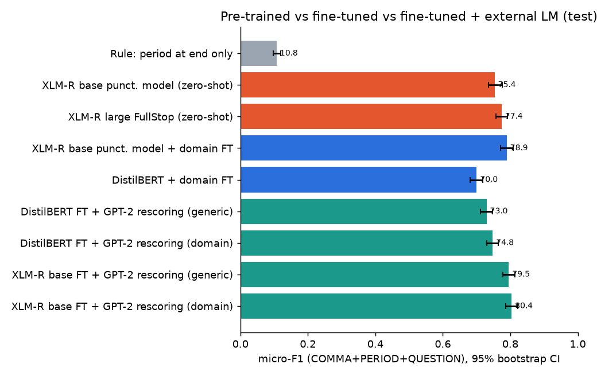

### Significance (paired bootstrap, micro-F1)

| comparison | Δ F1 | 95 % CI | p |
|---|---|---|---|
| XLM-R base: domain FT vs zero-shot | +3.6 | +2.6 … +4.5 | < 0.001 |
| XLM-R base FT: + domain GPT-2 vs none | +1.4 | +0.9 … +2.0 | < 0.001 |
| domain GPT-2 vs generic GPT-2 (XLM-R tagger) | +0.8 | +0.4 … +1.4 | < 0.001 |
| best system vs FullStop large (zero-shot) | +3.0 | +1.8 … +4.3 | < 0.001 |
| DistilBERT FT: + domain GPT-2 vs none | +4.8 | +3.7 … +5.8 | < 0.001 |

### Key findings
1. **Domain fine-tuning is effective.** The same pre-trained punctuation model improves by 3.6 micro-F1 and its slot error
   rate falls from 40.5 % to 32.7 %. Precision rises from 74.1 to 80.6: the model adopts the counsellors' sparser punctuation
   style and stops inserting marks they would not use.
2. **The external LM adds complementary gains.** GPT-2 rescoring mainly recovers missed marks (recall 77.4 → 80.3). A
   domain-adapted GPT-2 (validation perplexity 44.4 → 29.9) outperforms the generic one for both taggers.
3. **A fine-tuned base model beats a 2× larger zero-shot model** (80.4 vs 77.4).
4. **Task pre-training matters most at this data scale.** DistilBERT, which learns punctuation only from ~265 k training
   words, reaches 70.0 (74.8 with GPT-2), well below models that were already trained for punctuation.
5. **Commas benefit most from fine-tuning** (62.3 → 69.3 F1): comma usage is the most style- and domain-dependent decision.
6. **Reproducibility:** the notebook was re-run on a Colab T4 GPU; trained-model scores differ from the CPU run above by
   less than 1 point (best system 80.7 on GPU).

| | |
|---|---|
| 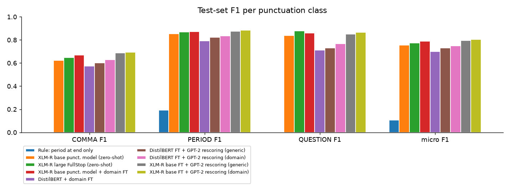 | 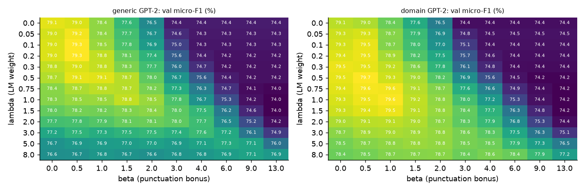 |

---

## 9. Error analysis

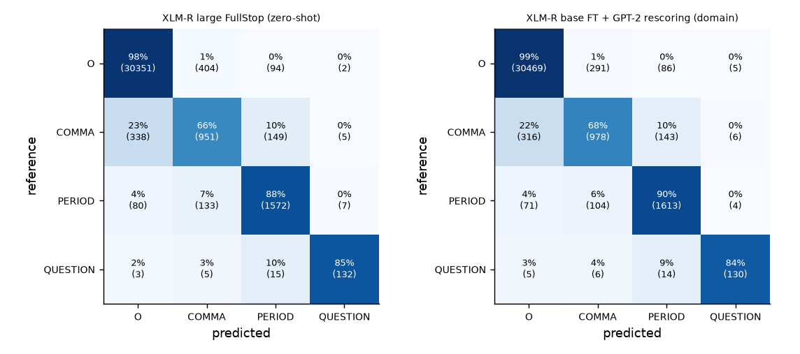

* The most frequent error is a **missed comma** (~22 % of reference commas predicted as `O`); many of these commas are optional.
* Mark-to-mark confusions are mostly **COMMA → PERIOD** (a long sentence split where the writer used a comma) and
  **QUESTION → PERIOD** (a rhetorical question recognised as a sentence end but not as a question).
* Fine-tuning mainly removes **insertions** (581 → 342 for XLM-R base); the external LM mainly removes **deletions** (476 → 392).
* Accuracy is highest for short and medium sentences (≈ 0.83 micro-F1 up to 20 words) and drops for sentences longer than 45 words.

| | |
|---|---|
| 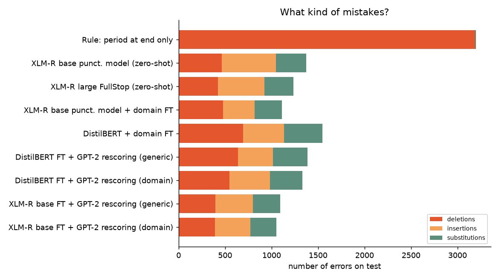 | 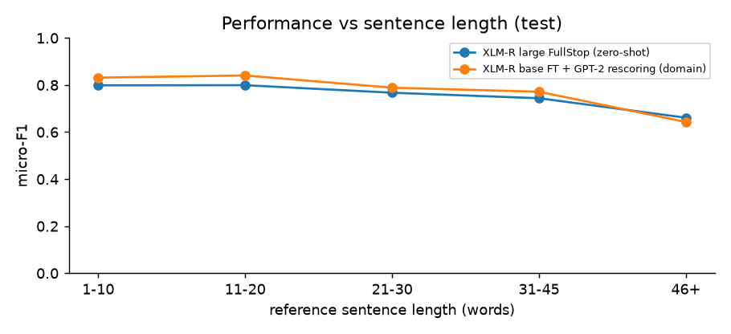 |

Example outputs are in [`results/tables/error_examples.md`](results/tables/error_examples.md).

---

## 10. Challenges and solutions

| # | challenge | solution |
|---|---|---|
| 1 | 3,710 sentence boundaries without a space (`with.Seriously`) would silently delete period labels | regex repair before lower-casing |
| 2 | encoding noise: non-breaking spaces, curly quotes, bullets, ellipses | Unicode NFKC + explicit character mapping |
| 3 | URLs, e-mails, base64 images and emoticons create fake punctuation | removed before labelling |
| 4 | Spanish responses and duplicates (incl. near-duplicates after cleaning) | language filter; de-duplication on the cleaned word sequence; split by response |
| 5 | words split into several sub-tokens | label only the first sub-token |
| 6 | responses longer than the model window | overlapping windows, most-central prediction per word |
| 7 | heavy class imbalance | per-class / micro / macro F1 and SER instead of accuracy; β bonus tuned on validation |
| 8 | different label sets in public models | probability folding into the 4 classes; for fine-tuning, the model's own head is reused |
| 9 | **found in error analysis:** models trained on random windows left the final word of ~60 % of validation responses unpunctuated (zero-shot models: 0 %) | end-of-input decoding constraint, validated on the validation set (+2.2 micro-F1 for fine-tuned taggers, no effect on zero-shot models) and applied identically to all systems; results with and without it are in [`results/tables/end_constraint_effect.csv`](results/tables/end_constraint_effect.csv) |
| 10 | first λ grid put the best DistilBERT setting on its edge | grid widened (λ ≤ 8, β ≤ 13); validation F1 is flat for λ ≥ 1 |
| 11 | CPU-only development machine with a throttled network proxy | parallel range downloader for checkpoints, cached intermediate outputs, GPU-ready notebook |

---

## 11. Project structure

```
.
├── src/punct/
│   ├── labels.py          label set, character folding, rendering, end-of-input constraint
│   ├── data.py            cleaning, filtering, word/label extraction, splitting, training windows
│   ├── tagger.py          token-classification model: label mapping, training loop, sliding-window inference
│   ├── lm_rescore.py      GPT-2 fine-tuning, perplexity, N-best generation and rescoring
│   ├── metrics.py         confusion matrix, P/R/F1, micro/macro F1, SER
│   └── paths.py           resolves locally downloaded checkpoints
├── scripts/
│   ├── 00_download_models.py   parallel checkpoint download (optional)
│   ├── 01_build_dataset.py     synthetic dataset creation
│   ├── 02_eda.py               exploratory data analysis
│   ├── 03_run_tagger.py        zero-shot evaluation and fine-tuning
│   ├── 04_external_lm.py       GPT-2 domain adaptation and N-best rescoring
│   ├── 05_evaluate_report.py   test evaluation, significance tests, figures
│   ├── predict.py              punctuate arbitrary text
│   └── run_queue.sh            sequential CPU job runner
├── notebooks/Punctuation_Restoration.ipynb   end-to-end Colab notebook (executed on a T4 GPU)
├── docs/Study_Guide.pdf / .html              long-form documentation
├── results/
│   ├── tables/            all metrics (CSV / JSON / Markdown)
│   ├── figures/           EDA and result figures
│   └── logs/              training and evaluation logs
└── requirements.txt
```

---

## 12. How to run

### Option A – Google Colab (recommended)
Click the **Open in Colab** badge at the top, select **Runtime → Change runtime type → T4 GPU**, then **Run all**.
The notebook writes the project files, downloads the dataset and all checkpoints, trains, evaluates and displays every
figure (well under an hour on a T4).

### Option B – local
```bash
git clone https://github.com/AbhishekSinghDasila/Punctuation-Restoration.git
cd Punctuation-Restoration
python -m venv venv
venv\Scripts\activate            # Windows   (Linux/macOS: source venv/bin/activate)
pip install -r requirements.txt
```
Download `train.csv` from the [Kaggle dataset](https://www.kaggle.com/datasets/thedevastator/nlp-mental-health-conversations)
into `data/raw/`, then run the pipeline:

```bash
python scripts/01_build_dataset.py
python scripts/02_eda.py

python scripts/03_run_tagger.py --tag punctall_zeroshot   --model kredor/punctuate-all
python scripts/03_run_tagger.py --tag fullstop_zeroshot   --model oliverguhr/fullstop-punctuation-multilang-large
python scripts/03_run_tagger.py --tag punctall_finetuned  --model kredor/punctuate-all    --train --epochs 1 --lr 2e-5
python scripts/03_run_tagger.py --tag distilbert_finetuned --model distilbert-base-uncased --train --epochs 3 --lr 5e-5

python scripts/04_external_lm.py --tagger punctall_finetuned
python scripts/04_external_lm.py --tagger distilbert_finetuned

python scripts/05_evaluate_report.py
```

### Punctuate your own text
```bash
python scripts/predict.py "have you talked to anyone about it it might help"
# Have you talked to anyone about it? It might help.

python scripts/predict.py --model models/punctall_finetuned --lm models/distilgpt2_domain --lam 0.5 --beta 0.5 \
    "what would it look like if you allowed yourself to rest without guilt you deserve it"
# What would it look like if you allowed yourself to rest without guilt? You deserve it.
```

| compute | CPU (6 threads) | Colab T4 |
|---|---|---|
| DistilBERT, 3 epochs | ~80 min | ~4 min |
| XLM-R base, 1 epoch | ~65 min | ~3.5 min |
| GPT-2 domain fine-tuning | ~40 min | a few minutes |
| N-best LM scoring (per tagger × LM) | ~15 min | ~1 min |

---

## 13. Limitations and future work

* **Written text vs. speech:** training data is clean written English. Real ASR output contains recognition errors,
  disfluencies and spoken-form numbers; training on ASR-noised text and adding **prosodic features** (pause durations) is
  the most important next step for dictation.
* **Larger models and more epochs:** XLM-R was fine-tuned for one epoch and the 560 M model was not fine-tuned (CPU budget).
* **Seeds:** one run per configuration; multi-seed mean ± std would tighten the comparison.
* **Training windows that end at true text ends** would remove the need for the end-of-input constraint.
* **Truecasing** (joint capitalisation head), **more classes** (`!`, `:`), **streaming** inference with limited look-ahead,
  and **quantised / distilled** models for low-latency deployment.

---

## 14. References

* Tilk & Alumäe (2016). *Bidirectional Recurrent Neural Network with Attention Mechanism for Punctuation Restoration.* Interspeech.
* Courtland, Faulkner & McElvaine (2020). *Efficient Automatic Punctuation Restoration Using Bidirectional Transformers with Robust Inference.* IWSLT.
* Guhr, Schumann, Bahrmann & Böhme (2021). *FullStop: Multilingual Deep Models for Punctuation Prediction.* SwissText.
* Conneau et al. (2020). *Unsupervised Cross-lingual Representation Learning at Scale* (XLM-RoBERTa). ACL.
* Sanh et al. (2019). *DistilBERT, a distilled version of BERT.* NeurIPS EMC² Workshop.
* Radford et al. (2019). *Language Models are Unsupervised Multitask Learners* (GPT-2).
* Dataset: *NLP Mental Health Conversations*, Kaggle.
